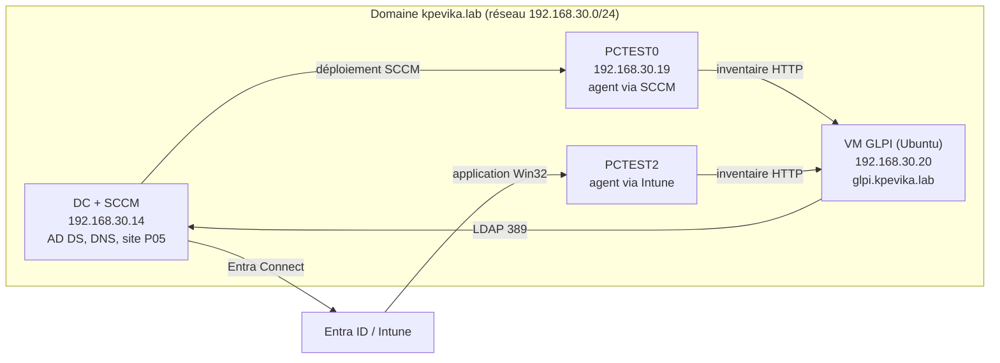

[README-GLPI-Lab.md](https://github.com/user-attachments/files/34215775/README-GLPI-Lab.md)

# GLPI Lab : ITSM relié à Active Directory, SCCM et Intune

Lab d'une solution ITSM (GLPI) intégrée à un environnement d'entreprise : annuaire Active Directory, déploiement d'applications par SCCM et par Intune, inventaire automatique du parc.

> Ce lab fait partie d'une série de labs d'infrastructure construite en vue d'un poste d'ingénieur systèmes (AD, GPO, SCCM, Intune, co-gestion, ITSM).

## Objectifs

- Installer et sécuriser GLPI sur Ubuntu (Apache, MariaDB, PHP)
- Structurer un support : entités, profils, catégories ITIL, SLA, cycle de vie d'un ticket
- Authentifier et importer les utilisateurs depuis Active Directory (LDAP)
- Inventorier automatiquement le parc avec le GLPI Agent
- Déployer l'agent **par SCCM** et **par Intune**, puis comparer les deux méthodes

## Architecture




## Environnement

| Élément | Détail |
|---|---|
| Hyperviseur | VMware |
| Serveur GLPI | Ubuntu Desktop (VM, 2 vCPU, 4 Go RAM, 40 Go), refait ensuite sur Ubuntu Server |
| Pile | Apache 2, MariaDB 11.8, PHP 8.5 |
| GLPI | 12.0.1 |
| Contrôleur de domaine | Windows Server 2022, AD DS, DNS, SCCM (site P05) |
| Clients | Windows 11 : PCTEST0 (SCCM), PCTEST2 (cogéré, Intune) |
| GLPI Agent | 1.21 |

---

## Phase 1 : Installation de GLPI

### 1.1 Pile LAMP

```bash
sudo apt update && sudo apt upgrade -y
sudo apt install -y apache2 mariadb-server php php-cli php-mysql php-curl php-gd php-intl \
  php-mbstring php-xml php-zip php-bz2 php-ldap php-apcu php-bcmath
sudo mariadb-secure-installation
```

`php-ldap` sert à l'intégration Active Directory, `php-bcmath` est exigé par GLPI 11 et 12.

### 1.2 Base de données

Dans le shell MariaDB (`sudo mariadb`) :

```sql
CREATE DATABASE glpi CHARACTER SET utf8mb4 COLLATE utf8mb4_unicode_ci;
CREATE USER 'glpi_user'@'localhost' IDENTIFIED BY '<MOT_DE_PASSE_LAB>';
GRANT ALL PRIVILEGES ON glpi.* TO 'glpi_user'@'localhost';
GRANT SELECT ON mysql.time_zone_name TO 'glpi_user'@'localhost';
FLUSH PRIVILEGES;
```

Chargement des fuseaux horaires, utilisés par GLPI :

```bash
sudo apt install -y mariadb-client-compat
mysql_tzinfo_to_sql /usr/share/zoneinfo | sudo mariadb mysql
sudo mariadb -e "SELECT COUNT(*) FROM mysql.time_zone_name;"   # doit être > 0
```

### 1.3 Déploiement de GLPI

```bash
sudo apt install -y curl
cd /tmp
wget $(curl -s https://api.github.com/repos/glpi-project/glpi/releases/latest \
  | grep browser_download_url | grep '\.tgz"' | cut -d '"' -f 4)
sudo tar -xzf glpi-*.tgz -C /var/www/
sudo chown -R www-data:www-data /var/www/glpi
```

### 1.4 Virtual host Apache

GLPI 11 et 12 doivent être servis depuis le dossier `public/`.

```apache
<VirtualHost *:80>
    ServerName localhost
    DocumentRoot /var/www/glpi/public

    <Directory /var/www/glpi/public>
        Require all granted
        RewriteEngine On
        RewriteCond %{REQUEST_FILENAME} !-f
        RewriteRule ^(.*)$ index.php [QSA,L]
    </Directory>
</VirtualHost>
```

```bash
sudo a2enmod rewrite
sudo a2dissite 000-default.conf
sudo a2ensite glpi.conf
sudo apache2ctl configtest && sudo systemctl restart apache2
```

Puis assistant d'installation sur `http://localhost` : langue, licence, vérification des prérequis, connexion à la base (`glpi_user`), initialisation.


### 1.5 Sécurisation après installation

- Changer ou désactiver les mots de passe des comptes de démonstration (`glpi`, `tech`, `normal`, `post-only`)
- Traiter les avertissements affichés par GLPI après la première connexion
- Utiliser un mot de passe dédié au lab pour la base de données

---

## Phase 2 : Configuration du support

### 2.1 Entités, utilisateurs, profils

Un **profil** est un ensemble de droits : *Super-Admin*, *Technician*, *Supervisor*, *Self-Service* (demandeur). Un utilisateur reçoit une ou plusieurs **habilitations** (entité + profil).

### 2.2 Catégories ITIL

*Configuration > Intitulés > Assistance > Catégories ITIL*, sur deux niveaux :

```
Poste de travail  > Matériel | Logiciel | Session/profil
Réseau            > Wi-Fi | VPN
Compte et accès   > Mot de passe | Droits d'accès
```

Chaque catégorie est visible pour les incidents et les demandes, et dans l'interface simplifiée, pour que le demandeur la voie dans son formulaire.


### 2.3 SLA

*Configuration > Niveaux de services* : SLA de résolution de 4 h (haute priorité) et de 8 h (priorité normale), appliqués aux tickets de test.

### 2.4 Cycle de vie d'un ticket

Incident créé par un demandeur, attribué à un technicien, suivi, solution, résolution, validation.


---

## Phase 3 : Réseau et DNS

Pour que le serveur soit joignable de façon stable par les agents :

- **IP fixe** sur la VM GLPI (profil NetworkManager dédié), le DC servant de DNS :

```bash
nmcli con add type ethernet ifname ens33 con-name lab-static \
  ipv4.method manual ipv4.addresses 192.168.30.20/24 ipv4.gateway 192.168.30.2 \
  ipv4.dns 192.168.30.14 ipv4.dns-search kpevika.lab
nmcli con mod netplan-ens33 connection.autoconnect no
nmcli con up lab-static
```

- **Redirecteur DNS** sur le DC pour les noms externes :

```powershell
Add-DnsServerForwarder -IPAddress 192.168.30.2
```

- **Enregistrement DNS** `glpi.kpevika.lab` :

```powershell
Add-DnsServerResourceRecordA -Name glpi -ZoneName kpevika.lab -IPv4Address 192.168.30.20
```

Les agents utilisent ensuite `http://glpi.kpevika.lab/front/inventory.php` : si l'IP change un jour, aucun client n'est à modifier.


---

## Phase 4 : Intégration Active Directory (LDAP)

### 4.1 Préparation dans l'AD

- Compte de service `svc-glpi`, en lecture seule
- Utilisateurs de test `hybride01`, `hybride02`, `hybride03` (synchronisés vers Entra ID par Entra Connect)

### 4.2 Annuaire dans GLPI

*Configuration > Authentification > Annuaires LDAP* :

| Paramètre | Valeur |
|---|---|
| Serveur / port | `192.168.30.14` / `389` |
| BaseDN | `DC=kpevika,DC=lab` |
| RootDN | `svc-glpi@kpevika.lab` |
| Champ de login | `samaccountname` |
| Filtre | `(&(objectClass=user)(objectCategory=person)(!(userAccountControl:1.2.840.113556.1.4.803:=2)))` |

Le bouton **Tester** valide la connexion, le bind et la recherche.


### 4.3 Import et profils

*Administration > Utilisateurs > Liaison annuaire LDAP > Importation de nouveaux utilisateurs*. Les comptes techniques (`svc-glpi`, `MSOL_...` d'Entra Connect, `Administrateur`) ne sont pas importés.

Un utilisateur importé reçoit le profil **Self-Service** par défaut. Habilitations attribuées à la main :

| Utilisateur | Profil |
|---|---|
| hybride01 | Technician |
| hybride02 | Supervisor |
| hybride03 | Self-Service |

Test de bout en bout : un ticket ouvert par `hybride03`, traité et résolu par `hybride01`, avec des comptes du domaine.


---

## Phase 5 : Inventaire avec le GLPI Agent

Activer l'inventaire dans *Administration > Inventaire > Configuration*.

Installation manuelle de validation sur un client (PowerShell administrateur) :

```powershell
msiexec /i C:\Temp\glpi-agent.msi /qn SERVER="http://glpi.kpevika.lab/front/inventory.php" `
  RUNNOW=1 ADD_FIREWALL_EXCEPTION=1 TAG=kpevika-lab
```

Inventaire forcé avec diagnostic :

```powershell
& "C:\Program Files\GLPI-Agent\glpi-agent.bat" --server http://glpi.kpevika.lab/front/inventory.php --force --debug
```


---

## Phase 6 : Déploiement de l'agent par SCCM

1. Source de l'application sur un partage (`\\<serveur>\Sources\GLPI-Agent\glpi-agent.msi`)
2. Application de type **Windows Installer (\*.msi)**, avec la ligne d'installation :

```
msiexec /i "glpi-agent.msi" /qn SERVER="http://glpi.kpevika.lab/front/inventory.php" RUNNOW=1 ADD_FIREWALL_EXCEPTION=1 TAG=kpevika-lab
```

3. Type de déploiement : installation pour le système, que l'utilisateur soit connecté ou non
4. Distribution du contenu vers le point de distribution
5. Collection de test `GLPI-Agent-Test` (règle directe sur `PCTEST0`)
6. Déploiement **Obligatoire**, puis téléchargement de la stratégie sur le client

L'agent installé à la main est désinstallé avant le test, sinon la détection le voit déjà présent et SCCM n'installe rien.


---

## Phase 7 : Déploiement de l'agent par Intune

Sur `PCTEST2`, cogéré, avec la charge « Applications clientes » basculée vers Intune.

1. Préparation du paquet :

```powershell
IntuneWinAppUtil.exe -c C:\Intune\GLPI-Agent -s glpi-agent.msi -o C:\Intune\Out -q
```

2. Application **Windows (Win32)** dans Intune :
   - Installation :
     ```
     msiexec /i "glpi-agent.msi" /qn SERVER="http://glpi.kpevika.lab/front/inventory.php" RUNNOW=1 ADD_FIREWALL_EXCEPTION=1 TAG=kpevika-intune
     ```
   - Désinstallation : `msiexec /x {<CODE_PRODUIT>} /qn`
   - Comportement : système, aucun redémarrage
   - Détection : règle MSI (code produit)
3. Groupe Entra `GLPI-Agent-Intune-Test` contenant `PCTEST2`, affectation **Obligatoire**
4. Synchronisation de l'appareil, puis contrôle de l'état d'installation

Le `TAG` distinct (`kpevika-intune`) permet de distinguer dans GLPI l'origine de chaque poste.


---

## Comparatif SCCM et Intune

| | SCCM | Intune |
|---|---|---|
| Packaging | Assistant MSI, source sur partage réseau | Fichier `.intunewin` (outil de préparation) |
| Distribution | Point de distribution, collection | Groupe Entra, affectation |
| Détection | Code produit MSI | Règle MSI |
| Forcer un déploiement | Notification du client, cycles d'évaluation | Synchronisation de l'appareil |
| Diagnostic | `C:\Windows\CCM\Logs` | `IntuneManagementExtension.log` |
| Dépendance réseau | Réseau local ou passerelle de gestion | Internet suffit |

En co-gestion, c'est la charge de travail « Applications clientes » qui détermine quel outil installe quoi.

---

## Problèmes rencontrés et solutions

| Problème | Cause | Solution |
|---|---|---|
| `CREATE : commande introuvable` | Commandes SQL collées dans bash | Ouvrir `sudo mariadb` avant de coller |
| `ERROR 1007` / `ERROR 1396` | Base et utilisateur existaient déjà | `DROP DATABASE` / `DROP USER`, puis recréation |
| `mysql_tzinfo_to_sql` introuvable | Commande absente avec MariaDB récent | Paquet `mariadb-client-compat` (ou `mariadb-tzinfo-to-sql`) |
| `Access denied for user 'glpi_user'` | Le mot de passe saisi n'était pas celui défini en base | `ALTER USER ... IDENTIFIED BY ...` puis test avec `mariadb -u glpi_user -p` |
| `wget` échoue, `curl` introuvable | Lien factice laissé dans la commande, curl non installé | Installer `curl`, récupérer l'URL via l'API GitHub |
| GLPI inaccessible sur `/glpi` | GLPI 11+ doit être servi depuis `public/` | Virtual host avec `DocumentRoot /var/www/glpi/public` |
| Sous-catégories mal rattachées | Champ « Comme enfant de » conservé d'une saisie à l'autre | Correction du parent dans chaque fiche |
| Import LDAP sans résultat | Page vide tant qu'aucune recherche n'est lancée | Lancer la recherche avec les champs vides |
| « Identifiant ou mot de passe incorrect » | Mot de passe AD erroné | Vérifier avec `ldapsearch` et réinitialiser le compte |
| « Vous n'avez pas les droits requis » | Profil Self-Service attribué par défaut | Ajouter une habilitation Technician |
| Client Windows : « nom distant non résolu » | DNS secondaire public (`8.8.8.8`) qui répond « nom inexistant » | Le DC comme seul DNS, avec redirecteur |
| VM : `SERVFAIL` sur les noms externes | DC sans redirecteur | `Add-DnsServerForwarder` |
| L'application SCCM ne s'installe pas | Agent déjà installé à la main | Désinstaller l'agent avant le test |
| Avertissements Perl (`$category`) | Module Firewall de l'agent | Sans gravité, ne bloque pas l'inventaire |

---

## Sécurité et limites

- LDAP en clair (port 389) : acceptable en lab, **LDAPS (636)** à utiliser en production
- Mots de passe de lab uniquement, aucun secret dans ce dépôt
- Comptes de démonstration GLPI à désactiver
- Serveur sur Ubuntu Desktop dans cette première version ; un serveur de production n'a pas d'interface graphique
- Pas de HTTPS ni de sauvegarde de la base à ce stade

## Suite du lab

- [ ] Règles métier : affectation automatique, SLA selon l'urgence
- [ ] Notifications par mail
- [ ] Base de connaissances, tableau de bord
- [ ] Profils attribués automatiquement selon les groupes AD
- [ ] Refaire le lab sur **Ubuntu Server** (HTTPS, sauvegardes, durcissement)

## Dépôts liés

Lien vers les autres labs de la série (AD/GPO, SCCM, Entra/Intune, co-gestion).
