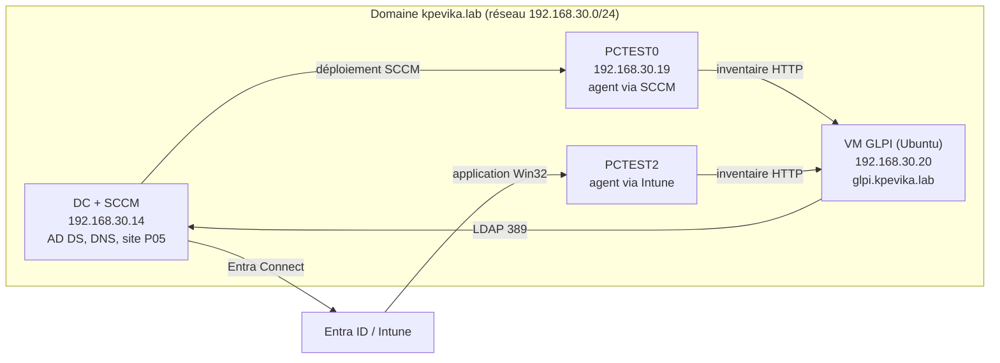

[README-GLPI-Lab2.md](https://github.com/user-attachments/files/34216214/README-GLPI-Lab2.md)
# GLPI Lab : ITSM relié à Active Directory, SCCM et Intune

Lab d'une solution ITSM (GLPI) intégrée à un environnement d'entreprise : annuaire Active Directory, déploiement d'applications par SCCM et par Intune, inventaire automatique du parc.

> Ce lab fait partie d'une série de labs d'infrastructure construite en vue d'un poste d'ingénieur systèmes (AD, GPO, SCCM, Intune, co-gestion, ITSM).

## Sommaire

1. Contexte et objectifs
2. Architecture
3. Environnement et prérequis
4. Phase 1 : Installation de GLPI
5. Phase 2 : Configuration du support (profils, catégories, SLA, tickets)
6. Phase 3 : Réseau et DNS
7. Phase 4 : Intégration Active Directory (LDAP)
8. Phase 5 : Inventaire avec le GLPI Agent
9. Phase 6 : Déploiement de l'agent par SCCM
10. Phase 7 : Déploiement de l'agent par Intune
11. Comparatif SCCM et Intune
12. Problèmes rencontrés et solutions
13. Sécurité, bonnes pratiques et limites
14. Compétences démontrées
15. Glossaire
16. Suite du lab

---

## 1. Contexte et objectifs

Dans un service de support poste de travail, trois besoins reviennent toujours : **suivre les demandes** des utilisateurs (tickets, délais), **connaître son parc** (quel matériel, quels logiciels) et **déployer des applications** de façon centralisée. GLPI couvre les deux premiers, SCCM et Intune le troisième. Ce lab les relie dans un même environnement.

Objectifs :

- Installer et sécuriser GLPI sur Ubuntu (Apache, MariaDB, PHP)
- Structurer un support : entités, profils, catégories ITIL, SLA, cycle de vie d'un ticket
- Authentifier et importer les utilisateurs depuis Active Directory (LDAP)
- Fiabiliser le réseau : IP fixe, DNS interne, nom de service dédié
- Inventorier automatiquement le parc avec le GLPI Agent
- Déployer l'agent **par SCCM** et **par Intune**, puis comparer les deux méthodes
- Documenter chaque étape, avec les erreurs rencontrées et leurs corrections

---

## 2. Architecture




### Machines

| Machine | Rôle | Adresse | Nom |
|---|---|---|---|
| Contrôleur de domaine | AD DS, DNS, serveur SCCM (site P05), Entra Connect | 192.168.30.14 | domaine `kpevika.lab` |
| VM GLPI | Serveur GLPI (Apache, MariaDB, PHP) | 192.168.30.20 (fixe) | `glpi.kpevika.lab` |
| PCTEST0 | Client Windows géré par SCCM, agent déployé par SCCM | 192.168.30.19 | |
| PCTEST2 | Client Windows cogéré, agent déployé par Intune | DHCP | |

Réseau : 192.168.30.0/24 (NAT VMware), passerelle 192.168.30.2.

### Flux réseau

| Source | Destination | Port | Usage |
|---|---|---|---|
| VM GLPI | DC | TCP 389 | Authentification et import LDAP |
| Clients | VM GLPI | TCP 80 | Envoi de l'inventaire par l'agent |
| Clients et VM | DC | TCP/UDP 53 | Résolution DNS |
| Serveur SCCM | Clients | | Gestion et déploiement |
| PCTEST2 | Intune (cloud) | HTTPS | Gestion et déploiement |

---

## 3. Environnement et prérequis

| Élément | Détail |
|---|---|
| Hyperviseur | VMware |
| Serveur GLPI | Ubuntu Desktop (VM 2 vCPU, 4 Go de RAM, 40 Go de disque), refait ensuite sur Ubuntu Server |
| Pile | Apache 2, MariaDB 11.8, PHP 8.5 |
| GLPI | 12.0.1 |
| Contrôleur de domaine | Windows Server 2022 : AD DS, DNS, SCCM |
| Clients | Windows 11 : PCTEST0 (SCCM), PCTEST2 (cogéré, Intune) |
| GLPI Agent | 1.21 |
| Cloud | Tenant Microsoft 365 avec Intune, synchronisation par Entra Connect |

Prérequis avant de commencer :

- Un domaine Active Directory fonctionnel, avec DNS
- Au moins un client Windows joint au domaine
- Pour les phases 6 et 7 : un site SCCM opérationnel avec un client enregistré, et un poste cogéré dans Intune
- Un accès Internet depuis la VM (téléchargement des paquets et de GLPI)

---

## 4. Phase 1 : Installation de GLPI

### 4.1 La VM

Deux cartes ou une seule selon le lab ; ici une carte (`ens33`) sur le réseau NAT, qui sert à la fois pour Internet et pour joindre le domaine. Vérification de l'adresse :

```bash
ip -4 addr
ip route | grep default
```

### 4.2 Pile LAMP

```bash
sudo apt update && sudo apt upgrade -y
sudo apt install -y apache2 mariadb-server php php-cli php-mysql php-curl php-gd php-intl \
  php-mbstring php-xml php-zip php-bz2 php-ldap php-apcu php-bcmath
sudo mariadb-secure-installation
```

| Paquet | Pourquoi |
|---|---|
| `apache2` | Serveur web |
| `mariadb-server` | Base de données de GLPI |
| `php` et extensions | `php-mysql` (accès base), `php-curl`, `php-gd`, `php-intl`, `php-mbstring`, `php-xml`, `php-zip`, `php-bz2` (exigées par GLPI), `php-apcu` (cache), `php-ldap` (intégration AD), `php-bcmath` (exigée à partir de GLPI 11) |

Vérification des services et de PHP :

```bash
php -v
systemctl status apache2 mariadb --no-pager
```

La version de PHP doit rester dans la plage supportée par la version de GLPI choisie ; l'assistant d'installation signale les incompatibilités à l'étape de vérification des prérequis.

### 4.3 Base de données

Dans le shell MariaDB (`sudo mariadb`, le prompt devient `MariaDB [(none)]>`) :

```sql
CREATE DATABASE glpi CHARACTER SET utf8mb4 COLLATE utf8mb4_unicode_ci;
CREATE USER 'glpi_user'@'localhost' IDENTIFIED BY '<MOT_DE_PASSE_LAB>';
GRANT ALL PRIVILEGES ON glpi.* TO 'glpi_user'@'localhost';
GRANT SELECT ON mysql.time_zone_name TO 'glpi_user'@'localhost';
FLUSH PRIVILEGES;
EXIT;
```

- Un utilisateur **dédié** limité à la base `glpi` : GLPI n'a pas besoin des droits root sur MariaDB.
- Le `GRANT SELECT` sur `mysql.time_zone_name` permet à GLPI de lire les fuseaux horaires.
- Chaque commande doit répondre `Query OK`.

Test de la connexion avec le nouvel utilisateur, depuis le terminal :

```bash
mariadb -u glpi_user -p glpi -e "SELECT 1;"
```

### 4.4 Fuseaux horaires

```bash
sudo apt install -y mariadb-client-compat
mysql_tzinfo_to_sql /usr/share/zoneinfo | sudo mariadb mysql
sudo mariadb -e "SELECT COUNT(*) FROM mysql.time_zone_name;"
```

La commande `mysql_tzinfo_to_sql` n'existe plus par défaut avec MariaDB récent : le paquet `mariadb-client-compat` la remet, et `mariadb-tzinfo-to-sql` fait la même chose. Le `COUNT(*)` doit être supérieur à 0 (486 dans ce lab).


### 4.5 Déploiement de GLPI

```bash
sudo apt install -y curl
cd /tmp
wget $(curl -s https://api.github.com/repos/glpi-project/glpi/releases/latest \
  | grep browser_download_url | grep '\.tgz"' | cut -d '"' -f 4)
ls -lh glpi-*.tgz
sudo tar -xzf glpi-*.tgz -C /var/www/
sudo chown -R www-data:www-data /var/www/glpi
ls /var/www/glpi
```

L'URL de l'archive est obtenue par l'API GitHub, ce qui évite de copier un lien à la main. Le dernier `ls` doit afficher notamment les dossiers `public`, `src` et `config`.


### 4.6 Virtual host Apache

À partir de GLPI 11, seul le dossier `public/` doit être exposé : le reste (code, configuration, fichiers) ne doit pas être accessible depuis le web. Il faut donc pointer le `DocumentRoot` dessus et réécrire les URL vers `index.php`.

`/etc/apache2/sites-available/glpi.conf` :

```apache
<VirtualHost *:80>
    ServerName localhost
    DocumentRoot /var/www/glpi/public

    <Directory /var/www/glpi/public>
        Require all granted
        RewriteEngine On
        RewriteCond %{REQUEST_FILENAME} !-f
        RewriteRule ^(.*)$ index.php [QSA,L]
    </Directory>
</VirtualHost>
```

```bash
sudo a2enmod rewrite
sudo a2dissite 000-default.conf
sudo a2ensite glpi.conf
sudo apache2ctl configtest      # attendu : Syntax OK
sudo systemctl restart apache2
```

L'avertissement `AH00558` (nom de serveur non défini) est sans gravité ; il disparaît avec :

```bash
echo "ServerName localhost" | sudo tee /etc/apache2/conf-available/servername.conf
sudo a2enconf servername && sudo systemctl reload apache2
```

### 4.7 Assistant d'installation

Dans un navigateur : `http://localhost`.

1. Langue, puis acceptation de la licence
2. Clic sur **Installer**
3. **Vérification de la compatibilité** : tout doit être vert ; les lignes orange ou rouges (version de PHP, extension manquante, paramètre de session) se corrigent avant de continuer
4. Connexion à la base : serveur `localhost`, utilisateur `glpi_user`, mot de passe défini en 4.3
5. Choix de la base existante `glpi`
6. Initialisation des tables, puis affichage des comptes par défaut


### 4.8 Sécurisation après installation

- Changer les mots de passe des comptes de démonstration (`glpi`, `tech`, `normal`, `post-only`), ou désactiver ceux dont on n'a pas besoin
- Traiter les avertissements affichés par GLPI après la première connexion : ils servent de liste de contrôle
- Utiliser un mot de passe de base de données dédié au lab, jamais réutilisé ailleurs

Les identifiants `glpi_user` (base de données) et `glpi` (compte GLPI) sont deux choses différentes : le premier n'ouvre pas l'interface web.

---


## 5. Phase 2 : Configuration du support

### 5.1 Profils et habilitations

Un **profil** est un ensemble de droits. Un utilisateur reçoit une ou plusieurs **habilitations**, c'est-à-dire un couple entité + profil.

| Profil | Usage |
|---|---|
| Super-Admin | Tous les droits (compte `glpi`) |
| Technician | Traite les tickets, gère l'inventaire |
| Supervisor | Suit les tickets, affecte, valide |
| Self-Service | Demandeur : crée et suit ses propres tickets (interface simplifiée) |

La liste se trouve dans *Administration > Profils*. Un utilisateur peut avoir plusieurs profils et changer de profil actif depuis le menu en haut à droite.


### 5.2 Catégories ITIL

*Configuration > Intitulés > Assistance > Catégories ITIL*, sur deux niveaux :

| Catégorie | Sous-catégories |
|---|---|
| Poste de travail | Matériel, Logiciel, Session/profil |
| Réseau | Wi-Fi, VPN |
| Compte et accès | Mot de passe, Droits d'accès |

Pour chaque catégorie : visible pour les **incidents** et les **demandes**, et dans l'**interface simplifiée**, sinon un demandeur ne la voit pas dans son formulaire. Une sous-catégorie se rattache à son parent via le champ *Comme enfant de* ; la liste doit afficher des noms complets de la forme `Poste de travail > Matériel`, sur deux niveaux au maximum.


### 5.3 SLA

*Configuration > Niveaux de services* :

| SLA | Type | Délai |
|---|---|---|
| SLA haute priorité | Temps de résolution | 4 h |
| SLA priorité normale | Temps de résolution | 8 h |

Un SLA de type *prise en compte* (délai avant le premier traitement) peut s'ajouter de la même façon. Appliqué à un ticket, le SLA calcule une **date d'échéance** affichée sur le ticket et dans la liste. Un calendrier (heures ouvrées) peut remplacer le décompte 24 h/24.

### 5.4 Cycle de vie d'un ticket

| Étape | Qui | Action dans GLPI | Statut |
|---|---|---|---|
| Création | Demandeur | Titre, description, type (incident ou demande), catégorie, urgence | Nouveau |
| Prise en charge | Technicien | Champ *Attribué à* | En cours (attribué) |
| Traitement | Technicien | Suivi (échanges), tâche (action planifiée) | En cours |
| Résolution | Technicien | Ajout d'une solution | Résolu |
| Validation | Demandeur | Approbation de la solution | Clos |

La **priorité** est calculée par GLPI à partir de l'urgence et de l'impact.


---

## 6. Phase 3 : Réseau et DNS

Pour que le serveur soit joignable de façon stable par les agents, trois éléments : une IP fixe, un DNS interne et un nom dédié. Sans eux, l'adresse du serveur peut changer (bail DHCP de quelques minutes) et tous les agents pointent alors dans le vide.

### 6.1 IP fixe sur la VM

Le profil NetworkManager `netplan-ens33` est généré par netplan et peut être régénéré au redémarrage. Un **nouveau profil** statique est créé et l'ancien désactivé. L'adresse choisie (`.20`) est hors de la plage DHCP du réseau NAT, après vérification qu'elle est libre.

```bash
ping -c 2 192.168.30.20        # ne doit pas répondre
nmcli con show                 # repérer le nom de la connexion associée à ens33
nmcli con add type ethernet ifname ens33 con-name lab-static \
  ipv4.method manual ipv4.addresses 192.168.30.20/24 ipv4.gateway 192.168.30.2 \
  ipv4.dns 192.168.30.14 ipv4.dns-search kpevika.lab
nmcli con mod netplan-ens33 connection.autoconnect no
nmcli con up lab-static
```

Le DNS de la VM est le contrôleur de domaine uniquement. Vérification, y compris après un redémarrage :

```bash
ip -4 addr show ens33
ping -c 2 192.168.30.14
ping -c 2 8.8.8.8
resolvectl query kpevika.lab
```

### 6.2 Redirecteur DNS sur le DC

Quand la VM n'interroge que le DC, celui-ci doit relayer les noms externes, sinon `apt` et GitHub deviennent injoignables par nom (`SERVFAIL`).

```powershell
Add-DnsServerForwarder -IPAddress 192.168.30.2
Get-DnsServerForwarder
nslookup github.com
```

### 6.3 Enregistrement du serveur GLPI

```powershell
Add-DnsServerResourceRecordA -Name glpi -ZoneName kpevika.lab -IPv4Address 192.168.30.20
```

### 6.4 Contrôles depuis le client Windows

```powershell
Resolve-DnsName glpi.kpevika.lab
Test-NetConnection glpi.kpevika.lab -Port 80
Get-DnsClientServerAddress -AddressFamily IPv4
```

Le client ne doit avoir que le DC (`192.168.30.14`) comme serveur DNS : un DNS public en secondaire répond « nom inexistant » pour un nom interne (voir la section 12). Les agents utiliseront `http://glpi.kpevika.lab/front/inventory.php` : si l'IP change un jour, aucun client n'est à modifier.


---

## 7. Phase 4 : Intégration Active Directory (LDAP)

### 7.1 Préparation dans l'AD

- Un **compte de service** `svc-glpi`, en lecture seule (un simple membre des *Utilisateurs du domaine* suffit pour lire l'annuaire), avec un mot de passe qui n'expire pas
- Des utilisateurs de test : `hybride01`, `hybride02`, `hybride03` (synchronisés vers Entra ID par Entra Connect)
- Facultatif : une OU dédiée et des groupes par rôle, qui serviront à attribuer les profils automatiquement


### 7.2 Test depuis la VM, avant de toucher à GLPI

```bash
sudo apt install -y ldap-utils netcat-openbsd
nc -zv 192.168.30.14 389
ldapsearch -x -H ldap://192.168.30.14 -D "svc-glpi@kpevika.lab" -W \
  -b "DC=kpevika,DC=lab" "(sAMAccountName=svc-glpi)" dn
```


Un résultat avec une ligne `dn:` prouve que le port est ouvert, que le compte de service s'authentifie et que le BaseDN est correct.

### 7.3 Annuaire dans GLPI

*Configuration > Authentification > Annuaires LDAP > Ajouter* :

| Paramètre | Valeur |
|---|---|
| Nom | `AD kpevika.lab` |
| Serveur par défaut | Oui |
| Serveur / port | `192.168.30.14` / `389` |
| BaseDN | `DC=kpevika,DC=lab` |
| RootDN | `svc-glpi@kpevika.lab` (mot de passe du compte de service) |
| Champ de login | `samaccountname` |
| Filtre de connexion | `(&(objectClass=user)(objectCategory=person)(!(userAccountControl:1.2.840.113556.1.4.803:=2)))` |

Le filtre sélectionne les comptes utilisateurs (`objectClass=user` et `objectCategory=person`) et **exclut les comptes désactivés** : la règle `userAccountControl:1.2.840.113556.1.4.803:=2` teste le bit « compte désactivé ». Une parenthèse oubliée donne zéro résultat sans message d'erreur.

Le bouton **Tester** déroule cinq contrôles : flux TCP, Base DN, URI LDAP, connexion (bind) et recherche. Dans ce lab, la recherche a renvoyé 6 entrées.


### 7.4 Import des utilisateurs

*Administration > Utilisateurs > Liaison annuaire LDAP > Importation de nouveaux utilisateurs* : la page est vide tant qu'aucune recherche n'est lancée. Avec tous les champs vides, **Rechercher** liste les comptes de l'annuaire. Six comptes remontent ici :

| Compte | Importé ? | Raison |
|---|---|---|
| `hybride01`, `hybride02`, `hybride03` | Oui | Utilisateurs de test |
| `svc-glpi` | Non | Compte de service |
| `MSOL_...` | Non | Compte technique créé par Entra Connect |
| `Administrateur` | Non | Compte d'administration |

### 7.5 Profils

Un utilisateur importé reçoit le profil **Self-Service** par défaut. Cette habilitation est marquée *(D)* pour dynamique, c'est-à-dire attribuée automatiquement à l'import. Habilitations ajoutées à la main (onglet *Habilitations* de la fiche) :

| Utilisateur | Profil | Entité |
|---|---|---|
| hybride01 | Technician | Entité racine |
| hybride02 | Supervisor | Entité racine |
| hybride03 | Self-Service | Entité racine |

Sans aucune habilitation, la connexion est refusée. Le profil actif se change depuis le menu en haut à droite, et un **profil par défaut** peut être choisi dans la fiche utilisateur.

### 7.6 Test de bout en bout

À la connexion, la **source d'authentification** doit être réglée sur `AD kpevika.lab`, et l'identifiant saisi sous la forme `hybride03` (pas `hybride03@kpevika.lab`).

1. `hybride03` crée un incident (« Mon poste ne démarre plus », catégorie `Poste de travail > Matériel`)
2. `hybride01` (Technician) prend le ticket en charge, ajoute un suivi puis une solution
3. `hybride03` consulte la solution et l'approuve

### 7.7 Diagnostic d'un échec d'authentification

Tester le compte directement contre l'AD, hors GLPI :

```bash
ldapsearch -x -H ldap://192.168.30.14 -D "hybride01@kpevika.lab" -W \
  -b "DC=kpevika,DC=lab" "(sAMAccountName=hybride01)" dn
```

En cas d'`Invalid credentials`, le code `data` du message donne la cause :

| Code | Signification |
|---|---|
| `52e` | Mot de passe incorrect |
| `525` | Utilisateur introuvable |
| `532` | Mot de passe expiré |
| `533` | Compte désactivé |
| `773` | Changement de mot de passe obligatoire à la prochaine connexion |
| `775` | Compte verrouillé |


---

## 8. Phase 5 : Inventaire avec le GLPI Agent

### 8.1 Principe

Le **GLPI Agent** est un service installé sur chaque poste. Il collecte le matériel, le système et les logiciels, puis envoie l'inventaire en HTTP à GLPI (`/front/inventory.php`). GLPI crée ou met à jour la fiche du poste dans *Parc > Ordinateurs*. L'inventaire doit être activé côté serveur : *Administration > Inventaire > Configuration*, option **Activer l'inventaire**.

### 8.2 Installation manuelle de validation

Avant d'automatiser, l'agent est installé à la main sur un client pour valider la chaîne complète (réseau, DNS, serveur). PowerShell en administrateur :

```powershell
msiexec /i C:\Temp\glpi-agent.msi /qn SERVER="http://glpi.kpevika.lab/front/inventory.php" `
  RUNNOW=1 ADD_FIREWALL_EXCEPTION=1 TAG=kpevika-lab
```

| Paramètre | Rôle |
|---|---|
| `/qn` | Installation silencieuse, sans interface |
| `SERVER` | Adresse de remontée de l'inventaire |
| `RUNNOW=1` | Lance un inventaire dès la fin de l'installation |
| `ADD_FIREWALL_EXCEPTION=1` | Ouvre le port de l'interface locale de l'agent dans le pare-feu |
| `TAG` | Étiquette visible dans GLPI, utile pour filtrer et identifier l'origine d'un poste |

### 8.3 Vérifications

```powershell
Get-Service *glpi*                      # le service doit être Running
Test-NetConnection glpi.kpevika.lab -Port 80
```

- L'interface locale de l'agent est accessible sur `http://localhost:62354` (bouton **Force an Inventory**)
- Inventaire forcé avec diagnostic :

```powershell
& "C:\Program Files\GLPI-Agent\glpi-agent.bat" --server http://glpi.kpevika.lab/front/inventory.php --force --debug
```

- Côté serveur, la requête doit apparaître dans le journal Apache :

```bash
sudo tail -n 20 /var/log/apache2/access.log     # chercher POST /front/inventory.php
```

| Code HTTP | Interprétation |
|---|---|
| `200` | GLPI a reçu l'inventaire |
| `403` | Inventaire refusé, souvent désactivé dans GLPI |
| `404` | Adresse de remontée incorrecte |
| aucune ligne | La requête n'arrive pas au serveur (réseau, DNS, service arrêté) |

Les journaux de l'agent se trouvent dans `C:\Program Files\GLPI-Agent\logs`. Des avertissements Perl du module Firewall (`Use of uninitialized value $category`) peuvent s'afficher : ils sont sans gravité et ne bloquent pas l'inventaire.


---

## 9. Phase 6 : Déploiement de l'agent par SCCM

Le client doit être un client SCCM actif : service `CcmExec` démarré, et appareil visible dans la console avec **Client = Oui** et **Activité du client = Actif**.

### 9.1 Source de l'application

Sur le serveur SCCM, un partage contenant l'MSI :

```powershell
New-Item -ItemType Directory -Path D:\Sources\GLPI-Agent -Force
New-SmbShare -Name Sources -Path D:\Sources -ReadAccess "Everyone"
$r = Invoke-RestMethod https://api.github.com/repos/glpi-project/glpi-agent/releases/latest
$url = ($r.assets | Where-Object name -like "*x64.msi").browser_download_url
Invoke-WebRequest $url -OutFile "D:\Sources\GLPI-Agent\glpi-agent.msi"
```

Le partage ouvert à tous en lecture convient à un lab ; en production, il est limité au compte machine du serveur de site.

### 9.2 Application

*Bibliothèque de logiciels > Gestion des applications > Applications > Créer une application*, type **Windows Installer (\*.msi)**, emplacement `\\<serveur>\Sources\GLPI-Agent\glpi-agent.msi`, nom `GLPI Agent`.

Dans les propriétés de l'application, onglet **Types de déploiement** > **Modifier** :

- Onglet *Programmes*, ligne d'installation :

```
msiexec /i "glpi-agent.msi" /qn SERVER="http://glpi.kpevika.lab/front/inventory.php" RUNNOW=1 ADD_FIREWALL_EXCEPTION=1 TAG=kpevika-lab
```

- Onglet *Expérience utilisateur* : **Installer pour le système**, **Que l'utilisateur soit connecté ou non**
- Méthode de détection : règle générée automatiquement à partir du code produit de l'MSI, laissée telle quelle

L'onglet *Paramètres de distribution* de l'application garde ses valeurs par défaut.

### 9.3 Distribution et déploiement

1. **Distribuer le contenu** vers le point de distribution, puis contrôler dans *Surveillance > État de la distribution > État du contenu* que le contenu est à 100 %
2. Créer le regroupement de périphériques `GLPI-Agent-Test`, avec une **règle d'adhésion directe** : classe *Ressource système*, attribut **Nom**, valeur `PCTEST0`
3. **Déployer** l'application sur ce regroupement, objectif **Obligatoire**, échéance dès que possible
4. Sur le client : **Notification du client > Télécharger la stratégie de l'ordinateur** (console), puis *Cycle d'évaluation du déploiement d'applications* (Panneau de configuration > Configuration Manager > Actions)

### 9.4 Désinstaller l'agent manuel avant le test

Si l'agent installé à la main en phase 5 est encore présent, la règle de détection le trouve et SCCM n'installe rien, ce qui masque le déploiement. Désinstallation avant de lancer le test :

```powershell
Get-Package *GLPI* | Uninstall-Package
Get-Service *glpi*          # ne doit plus rien renvoyer
```

### 9.5 Vérifications et journaux

- Centre logiciel du client : application installée
- `Get-Service *glpi*` : service en cours d'exécution
- GLPI : date du dernier inventaire récente dans la fiche du poste

Journaux sur le client, dans `C:\Windows\CCM\Logs` :

| Fichier | Contenu |
|---|---|
| `AppDiscovery.log` | Évaluation de la détection (l'application est-elle déjà installée ?) |
| `AppEnforce.log` | Lancement de l'installation et code de retour |
| `execmgr.log` | Exécution des déploiements |


---

## 10. Phase 7 : Déploiement de l'agent par Intune

Cible : `PCTEST2`, un poste **cogéré** dont la charge de travail « Applications clientes » est basculée vers Intune. Sans cette bascule, c'est SCCM qui reste maître du déploiement d'applications.

### 10.1 Contrôle préalable

Depuis `PCTEST2` :

```powershell
Resolve-DnsName glpi.kpevika.lab
Test-NetConnection glpi.kpevika.lab -Port 80
```

### 10.2 Préparation du paquet

Intune installe les applications Win32 à partir d'un fichier `.intunewin`, produit par l'outil de préparation de contenu Microsoft (dépôt GitHub `microsoft/Microsoft-Win32-Content-Prep-Tool`).

```powershell
New-Item -ItemType Directory -Path C:\Intune\GLPI-Agent, C:\Intune\Out -Force
Copy-Item C:\Temp\glpi-agent.msi C:\Intune\GLPI-Agent\
IntuneWinAppUtil.exe -c C:\Intune\GLPI-Agent -s glpi-agent.msi -o C:\Intune\Out -q
```

Le code produit de l'MSI, nécessaire pour la commande de désinstallation :

```powershell
$i = New-Object -ComObject WindowsInstaller.Installer
$db = $i.OpenDatabase("C:\Intune\GLPI-Agent\glpi-agent.msi", 0)
$v = $db.OpenView("SELECT Value FROM Property WHERE Property='ProductCode'")
$v.Execute(); $v.Fetch().StringData(1)
```

### 10.3 Application dans Intune

*Applications > Windows > Ajouter > Application Windows (Win32)*, avec le fichier `.intunewin` :

| Paramètre | Valeur |
|---|---|
| Nom / éditeur | `GLPI Agent` / `GLPI Project` |
| Installation | `msiexec /i "glpi-agent.msi" /qn SERVER="http://glpi.kpevika.lab/front/inventory.php" RUNNOW=1 ADD_FIREWALL_EXCEPTION=1 TAG=kpevika-intune` |
| Désinstallation | `msiexec /x {<CODE_PRODUIT>} /qn` |
| Comportement d'installation | Système, aucun redémarrage |
| Exigences | Windows 10 1607 minimum, architecture 64 bits |
| Détection | Règle MSI (code produit, préremplie depuis le paquet) |

Le `TAG=kpevika-intune` (au lieu de `kpevika-lab`) permet de distinguer dans GLPI les postes arrivés par Intune de ceux arrivés par SCCM.

### 10.4 Affectation

Un groupe de sécurité Entra `GLPI-Agent-Intune-Test`, avec `PCTEST2` comme **appareil** membre, affecté en **Obligatoire**. `PCTEST0`, qui a déjà l'agent par SCCM, ne fait pas partie de ce groupe.

### 10.5 Synchronisation et suivi

- Dans Intune, ouvrir l'appareil puis **Synchroniser** ; sur le poste, *Paramètres > Comptes > Accès Professionnel ou École > Informations > Synchroniser*
- Une notification « Téléchargement et installation du logiciel » s'affiche, puis l'installation silencieuse démarre
- *Applications > GLPI Agent > État de l'installation des appareils* : le poste passe à **Installé**
- Journal en cas de problème : `C:\ProgramData\Microsoft\IntuneManagementExtension\Logs\IntuneManagementExtension.log`
- GLPI : `PCTEST2` apparaît dans *Parc > Ordinateurs* avec l'étiquette `kpevika-intune`


---

## 11. Comparatif SCCM et Intune

| | SCCM | Intune |
|---|---|---|
| Packaging | Assistant MSI, source sur partage réseau | Fichier `.intunewin` (outil de préparation) |
| Cible de déploiement | Regroupement (règle directe ou requête) | Groupe Entra |
| Distribution du contenu | Point de distribution à alimenter | Stockage cloud Microsoft |
| Détection | Code produit MSI (automatique) | Règle MSI (préremplie) |
| Forcer un déploiement | Notification du client, cycles d'évaluation | Synchronisation de l'appareil |
| Diagnostic | `C:\Windows\CCM\Logs` | `IntuneManagementExtension.log` |
| Dépendance réseau | Réseau local ou passerelle de gestion | Internet suffit |
| Délai constaté dans ce lab | à compléter | à compléter |

En co-gestion, c'est la charge de travail « Applications clientes » qui détermine quel outil installe quoi : tant qu'elle reste sur ConfigMgr, SCCM déploie ; une fois basculée en pilote ou sur Intune, c'est Intune.

---

## 12. Problèmes rencontrés et solutions

### Installation et base de données

| Symptôme | Cause | Solution |
|---|---|---|
| `CREATE : commande introuvable` | Commandes SQL collées dans le terminal bash | Ouvrir `sudo mariadb` d'abord ; le prompt doit devenir `MariaDB [(none)]>` |
| `ERROR 1007` (base existe) et `ERROR 1396` (utilisateur existe) | Reste d'une installation précédente | `DROP DATABASE glpi;` et `DROP USER 'glpi_user'@'localhost';`, puis recréation |
| `mysql_tzinfo_to_sql` introuvable | Commande absente avec MariaDB récent | Paquet `mariadb-client-compat`, ou `mariadb-tzinfo-to-sql` |
| `Access denied for user 'glpi_user'` dans l'assistant | Le mot de passe saisi n'était pas celui défini en base (texte factice laissé dans la commande `CREATE USER`) | `ALTER USER 'glpi_user'@'localhost' IDENTIFIED BY '...';` puis test avec `mariadb -u glpi_user -p glpi -e "SELECT 1;"` |
| `wget` : adresse introuvable ; `curl` : commande introuvable | Lien factice laissé dans la commande ; `curl` non installé | Installer `curl`, récupérer l'URL de l'archive par l'API GitHub |
| GLPI ne s'affiche pas sur `/glpi` | GLPI 11 et 12 doivent être servis depuis `public/` | Virtual host avec `DocumentRoot /var/www/glpi/public` et réécriture vers `index.php` |

### Configuration de GLPI et LDAP

| Symptôme | Cause | Solution |
|---|---|---|
| Sous-catégories sur trois niveaux | Champ « Comme enfant de » conservé d'une saisie à l'autre | Corriger le parent dans chaque fiche |
| Import LDAP : « Aucun résultat trouvé » | Page vide tant qu'aucune recherche n'est lancée | Lancer **Rechercher** avec les champs vides |
| « Identifiant ou mot de passe incorrect » | Mot de passe AD erroné | Test `ldapsearch` direct, réinitialisation du mot de passe dans l'AD |
| « Vous n'avez pas les droits requis pour réaliser cette action » | Profil Self-Service attribué par défaut à l'import | Ajouter une habilitation Technician dans la fiche utilisateur |

### Réseau et DNS

| Symptôme | Cause | Solution |
|---|---|---|
| Client : « le nom distant n'a pas pu être résolu » alors que `nslookup` fonctionne | Le client avait un DNS public (`8.8.8.8`) en secondaire, qui répond « nom inexistant » pour un nom interne ; `nslookup` interroge le DC directement, le résolveur Windows non | `Set-DnsClientServerAddress` avec le DC comme seul DNS, puis `ipconfig /flushdns` |
| VM : `SERVFAIL` sur `github.com` | Le DC n'avait pas de redirecteur | `Add-DnsServerForwarder -IPAddress 192.168.30.2` |
| Résolution lente ou capricieuse sur le DC | Redirecteur inutile hérité d'un autre réseau virtuel (`192.168.64.2`) | `Remove-DnsServerForwarder` sur l'adresse concernée |
| Adresse de la VM qui change | Bail DHCP de quelques minutes | Profil statique `lab-static` et enregistrement DNS `glpi` |

### Agent et déploiements

| Symptôme | Cause | Solution |
|---|---|---|
| `http://localhost:62354` inaccessible | Service de l'agent arrêté ou agent non installé | `Get-Service *glpi*`, `Start-Service "GLPI-Agent"`, ou réinstallation avec journal : `msiexec /i ... /qn /l*v C:\Temp\glpi-install.log` |
| Avertissements Perl (`$category`) à l'inventaire forcé | Module Firewall de l'agent | Sans gravité ; vérifier l'envoi dans `access.log` côté serveur |
| L'application SCCM ne s'installe pas | Agent déjà installé à la main : la détection le voit présent | Désinstaller l'agent avant le test |
| `Get-Service DNS` ou `Get-DnsServerResourceRecord` introuvables | Commande lancée sur le client au lieu du DC | Les lancer sur le serveur qui porte le rôle DNS |

---

## 13. Sécurité, bonnes pratiques et limites

Ce qui est en place :

- Utilisateur de base de données dédié, limité à la base `glpi`
- Seul le dossier `public/` de GLPI est exposé par Apache
- Compte de service LDAP en lecture seule
- Comptes techniques (service, Entra Connect, administrateur) non importés dans GLPI
- Profils séparés : un demandeur ne voit pas l'administration

Limites de cette version :

- **LDAP en clair** (port 389) : acceptable en lab, **LDAPS (636)** à utiliser en production
- Pas de **HTTPS** sur GLPI ni de **sauvegarde** de la base
- Serveur sur **Ubuntu Desktop** ; un serveur de production n'a pas d'interface graphique
- Partage de sources SCCM ouvert en lecture à tous
- Mots de passe de lab uniquement : aucun secret dans ce dépôt, et les captures sont floutées avant publication

Bonnes pratiques retenues :

- Travailler en utilisateur normal avec `sudo` plutôt qu'en session root
- Vérifier une adresse IP libre avant de la fixer
- Tester une brique avant la suivante : TCP, puis DNS, puis authentification, puis application
- Prendre un snapshot de chaque VM à la fin de chaque phase

---

## 14. Compétences démontrées

- Administration Linux : Apache, MariaDB, PHP, NetworkManager, journaux
- Services d'annuaire : Active Directory, LDAP, comptes de service, filtres
- Réseau : IP fixe, DNS (zones, enregistrements, redirecteurs), diagnostic de résolution
- ITSM et ITIL : profils, catégories, SLA, cycle de vie d'un ticket
- Gestion de parc : inventaire automatisé avec GLPI Agent
- Déploiement d'applications : SCCM (applications, regroupements, détection) et Intune (Win32, groupes Entra, co-gestion)
- Méthode de diagnostic et documentation d'incidents

---

## 15. Glossaire

| Terme | Définition |
|---|---|
| ITSM | Gestion des services informatiques (tickets, incidents, demandes, parc) |
| ITIL | Référentiel de bonnes pratiques de gestion des services |
| SLA | Engagement sur un délai de prise en charge ou de résolution |
| LDAP | Protocole d'interrogation d'un annuaire comme Active Directory |
| Bind | Authentification d'un compte auprès de l'annuaire |
| Habilitation | Attribution d'un profil à un utilisateur pour une entité |
| Co-gestion | Gestion d'un même poste par SCCM et Intune, charge de travail par charge de travail |
| Win32 (Intune) | Type d'application déployée à partir d'un fichier `.intunewin` |
| Entra Connect | Outil de synchronisation de l'AD local vers Entra ID |

---

## 16. Suite du lab

- [ ] Règles métier : affectation automatique, SLA selon l'urgence
- [ ] Notifications par mail
- [ ] Base de connaissances, tableau de bord
- [ ] Profils attribués automatiquement selon les groupes AD
- [ ] Refaire le lab sur **Ubuntu Server** (HTTPS, sauvegardes, durcissement)
- [ ] LDAPS à la place de LDAP en clair

## Dépôts liés

Liens vers les autres labs de la série (AD et GPO, SCCM, Entra et Intune, co-gestion).
